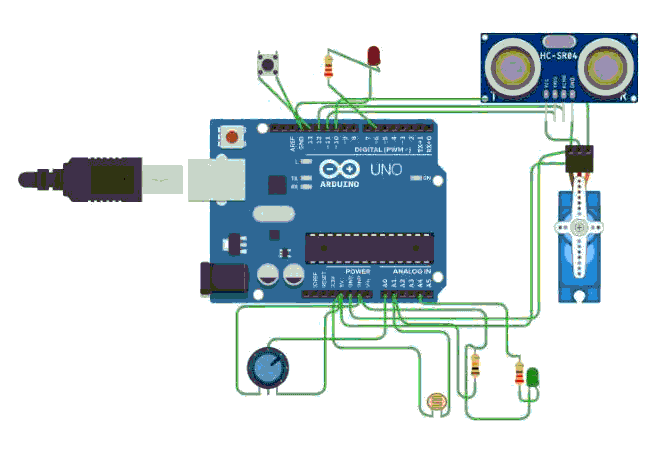
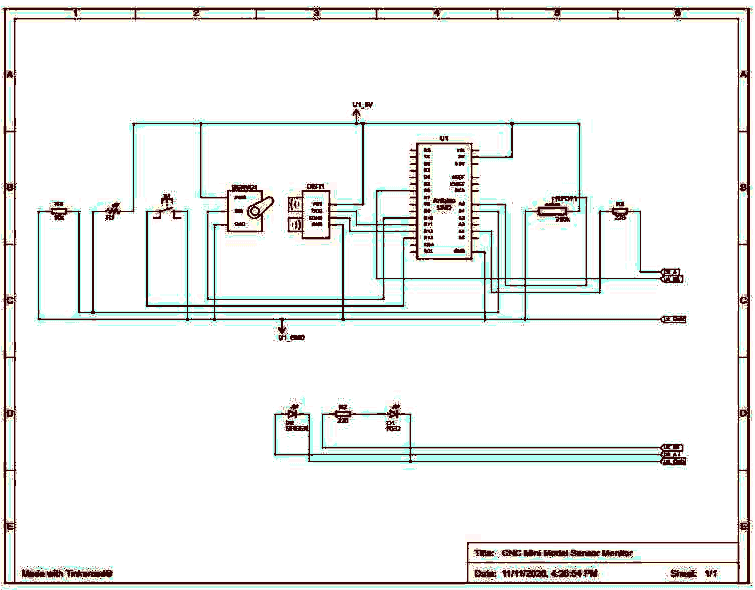
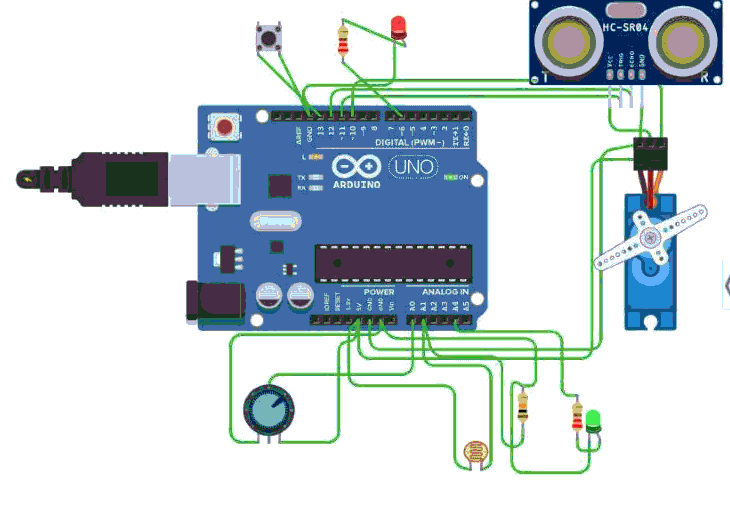

# CNC Mini-Model – Sensor Data Acquisition (Tinkercad Circuit)

**Live Tinkercad project:** https://www.tinkercad.com/things/gmXDUARyVsX/editel?sharecode=LZ3iawvSzJGFrgtO-c1xq9rfdtzwbdeWtW_FvahhG5A
**Board:** Arduino Uno R3

## 1. Overview
This project is the electronics of a mini CNC demonstration model. Sensors on the model simulate machine operating conditions, and an Arduino Uno collects their readings and shows the machine status. The circuit and code come from the project's design conversation and were rebuilt in Tinkercad Circuits for simulation and review.

## 2. Objective
- Collect real-time readings from several sensors (distance, light, manual analog input, button, vibration, temperature, IR, colour).
- Signal abnormal conditions on LEDs: **red** for a button press or an obstacle within 10 cm, **green** for vibration.
- Stream all readings over Serial at 9600 baud, ready for a future AI / predictive-maintenance layer.

## 3. Components
See [`Documentation/Component_List.md`](Documentation/Component_List.md).

| Built in Tinkercad | Not available in Tinkercad (pins kept free) |
|---|---|
| Arduino Uno R3, HC-SR04, push button, red LED, green LED, 2 × 220 Ω, potentiometer, micro servo (SG90), photoresistor + 10 kΩ (LDR module) | Vibration sensor (A3), IR obstacle sensor (D4), DHT11 (D7), TCS3200 colour sensor (D2, D3, D5, D8, D9) |

## 4. Working principle
- **HC-SR04 (D11/D12):** D11 sends a 10 µs trigger pulse. The echo pulse width on D12 is converted to distance with `duration × 0.0343 / 2` (cm). A distance of 10 cm or less counts as an obstacle.
- **Push button (D13):** uses the internal pull-up, so the pin reads LOW when the button is pressed.
- **Red LED (D6):** ON when the button is pressed OR an obstacle is detected.
- **Green LED (A4):** ON when the vibration input (A3) reads LOW.
- **Potentiometer (A0) → servo (D10):** the 0–1023 reading is mapped to 0–180°.
- **LDR (A1):** a voltage divider gives a light-level reading.
- **TCS3200 / DHT11 / IR:** read and printed on the real board only.

## 5. Pin connections
Full table: [`Documentation/Pin_Connection_Table.md`](Documentation/Pin_Connection_Table.md)

| Component | Arduino Uno pin |
|---|---|
| Potentiometer wiper | A0 |
| LDR output | A1 |
| Vibration sensor | A3 |
| Green LED (via 220 Ω) | A4 |
| TCS3200 OUT | D2 |
| TCS3200 S1 | D3 |
| IR sensor | D4 |
| TCS3200 S0 | D5 |
| Red LED (via 220 Ω) | D6 |
| DHT11 DATA | D7 |
| TCS3200 S2 / S3 | D8 / D9 |
| Servo signal | D10 |
| HC-SR04 TRIG | D11 |
| HC-SR04 ECHO | D12 |
| Push button | D13 |
| All VCC / GND | 5V / GND |

## 6. Power supply
- The Arduino Uno is powered over USB (5 V). All sensors, the servo and the LDR divider take 5 V from the Uno's 5V pin, and all grounds are common.
- LED current with 220 Ω is about (5 − 2) / 220 ≈ 14 mA, within the Uno's pin limit.
- On real hardware, a servo under load can draw more current than USB supplies. An external 5 V supply with a common ground is recommended.

## 7. Arduino code
[`Arduino_Code/circuit.ino`](Arduino_Code/circuit.ino) is the conversation's final sketch. The **only change** is a `USE_DHT11` switch:
- `USE_DHT11 0` (Tinkercad): `DHT.h` is not included and temperature/humidity print "Not available". Tinkercad has no DHT library, so the original would not compile there.
- `USE_DHT11 1` (real board): this restores the original DHT11 code exactly. Install the Adafruit "DHT sensor library" first.

Everything else is unchanged: pins, thresholds and LED logic. The one other edit is a label print fix: the original printed "Red LED:" with `println`, which split the label and its value onto separate lines.

## 8. How to run the simulation
1. Open the live Tinkercad link and click **Start Simulation**.
2. Open **Code → Serial Monitor** to see the readings.
3. Click the ultrasonic sensor and drag its target ball closer than 10 cm. The red LED turns on.
4. Press and hold the push button. The red LED turns on.
5. Drag the potentiometer knob. The servo turns.

## 9. Test results
Details: [`Simulation/Simulation_Report.md`](Simulation/Simulation_Report.md) and [`Documentation/Verification_Report.md`](Documentation/Verification_Report.md)

- 22/22 supported connections verified against the netlist exported from Tinkercad.
- The sketch compiles and runs in Tinkercad with no errors.
- Obstacle at 8.5 cm: `Obstacle: YES`, red LED ON. Potentiometer 696: servo 122°.

## 10. Project files
| File | Description |
|---|---|
| `Tinkercad_Files/circuit.brd` | Eagle board file exported by Tinkercad (Send To → .BRD) |
| `Arduino_Code/circuit.ino` | Arduino sketch |
| `Documentation/*.md` | Component list, pin table, verification report |
| `Screenshots/*.png` | Circuit, schematic and simulation screenshots |
| `Simulation/Simulation_Report.md` | Simulation test log |

## 11. Known limitations
- The vibration sensor, IR sensor, DHT11 and TCS3200 are not part of Tinkercad's parts library, so they are not in the simulation. Their pins are left free so the real-board pin map is unchanged.
- With no vibration sensor on A3, Tinkercad reads the open pin as LOW, so the **green LED shows ON in the simulation**. On the real board with the sensor fitted, it lights only on vibration.
- The potentiometer value was not specified in the conversation, so Tinkercad's default of 250 kΩ was kept. Any value from 10 kΩ upwards works.
- This is simulation verification only. Real-hardware validation is separate.
- The Tinkercad link is a collaboration link, so anyone with it can edit the design.
